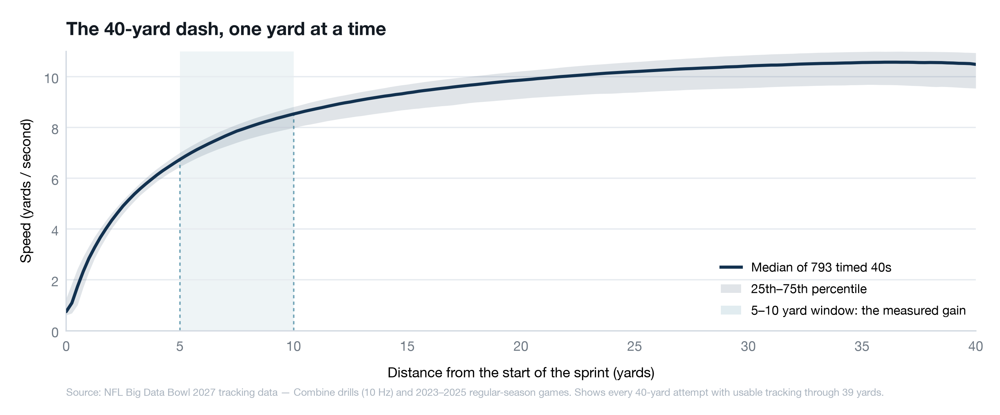
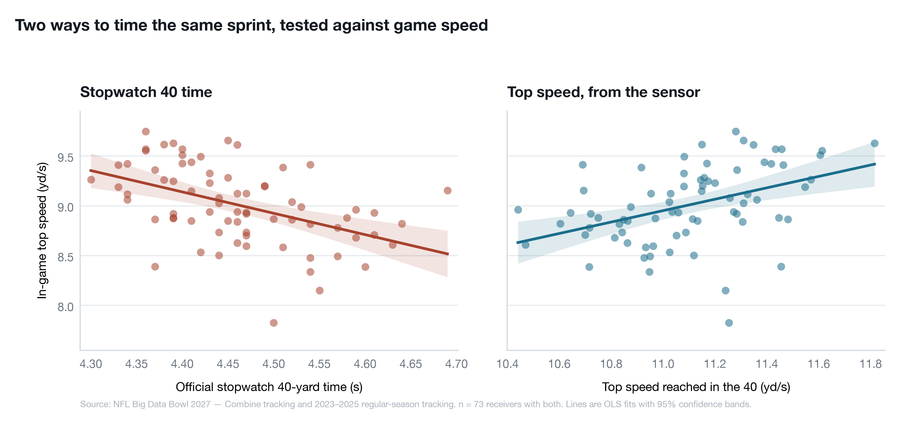
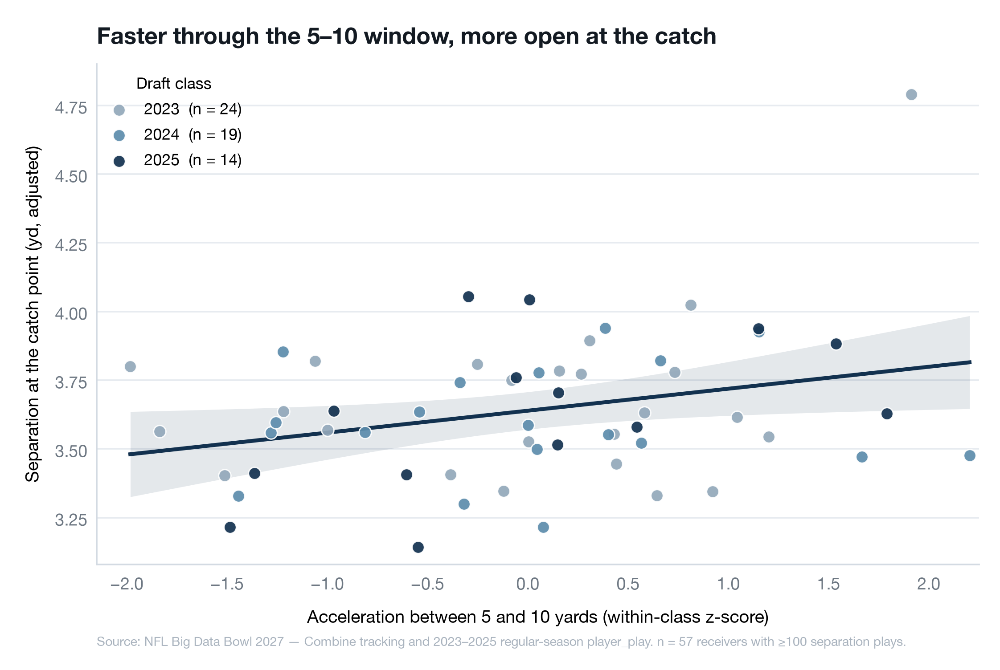
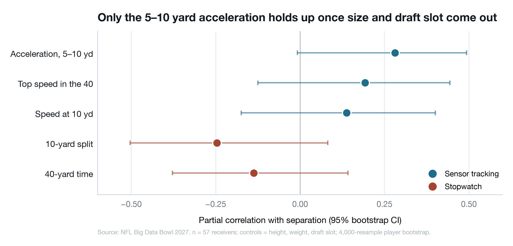
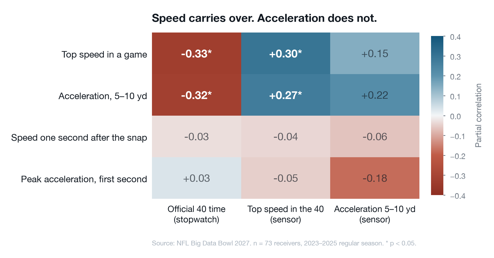
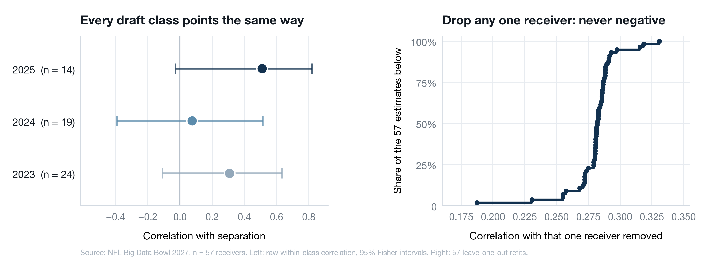
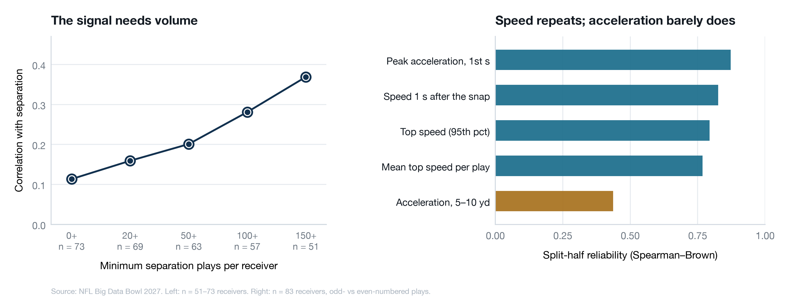
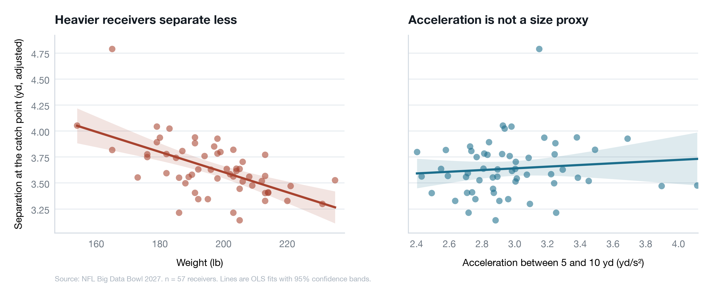

# Two clocks, one sprint

**NFL Big Data Bowl 2027 · University Track**

## 1. What a team can do with this

The sensor in Indianapolis measures what the 40-yard dash is trying to measure, and on this evidence it measures it no worse. Seventy-three receivers in these three draft classes have both Combine 40 tracking and regular-season game tracking. After height, weight and draft slot come out, the official 40 time correlates −0.33 with the top speed that receiver actually reaches in a game (p = .006). The top speed read directly off the Combine sensor correlates +0.30 (p = .013). Eighty-six of the 510 prospects here have no 40 time at all; for them the sensor is not a redundancy, it is the measurement.

The second result is smaller and we will not inflate it. Receivers who gain more speed between the 5- and 10-yard marks of the 40 are more open at the catch: partial r = +0.28, p = .040, n = 57. One standard deviation of that acceleration is worth about three inches of separation. The result does not survive correction for testing three measures at once, and its confidence interval touches zero. Use it to break a tie between two receivers of similar size. Do not build a route tree on it.

## 2. Data and method

Nine files, 2.15 GiB: 510 prospects from the 2023–2025 classes, 463,189 frames of 10 Hz Combine sensor data (`combine_tracking.csv`), and 22.7 million frames of 10 Hz game tracking (`game_tracking_2023–25.csv`) across 1,002 games.

Regular season only. Eighteen percent of the player-plays in these files are preseason or postseason, and dropping them is not cosmetic — it moves one draft class's estimate from −0.42 to −0.22.

**Predictor.** The 40 has no starting signal, so we never try to rebuild the stopwatch. We take instantaneous speed at fixed yard marks and compute acceleration across the 5-to-10-yard window as (v10² − v5²) / (2 × 5). That number exists for all 784 usable sprints by 418 players, timed or not. Figure 1 shows why: the sprint is still gaining speed hardest between those two marks.

*Figure 1. The 40 is an acceleration curve, not a number: across 793 sprints the median climbs from 6.74 to 8.53 yards per second between the 5- and 10-yard marks, a slope that needs no starting gun.*

**Outcome.** Separation at the catch point from the play file — 31,035 regular-season routes by 83 receivers — residualised on route × man-zone × down × season, so a receiver is compared with what an average receiver gains on the same route against the same coverage on the same down. That is the fairest baseline available and it also throws away real information about route skill; we chose the conservative version deliberately.

**Test.** Partial correlation controlling height, weight and draft slot, with 4,000 player-level bootstrap resamples. Draft slot is the important control: it removes what the market already believed about the player, so the test asks whether the sensor adds anything beyond the consensus. Deliberately not a model either — separation varies 2.09 yards within a receiver and 0.45 yards between receivers (ICC 0.045), so a flexible model would learn noise, and 57 players cannot fit one.

## 3. The stopwatch is not the only instrument

*Figure 2. Two instruments, one outcome, n = 73. The official 40 slopes down because a smaller time is faster (partial r = −0.33, p = .006); the sensor's top speed slopes up (+0.30, p = .013). Neither dominates, and the sensor needs nobody to trigger a clock.*

**Figure 2** is the core of the case. The sensor, which requires no one to press anything at the right instant, is not the weaker instrument — it is level with the number that goes on the draft card. With 73 receivers we can say the sensor is not much worse; we cannot say the two are identical, and the gap between −0.33 and +0.30 is well inside the noise. It should not be surprising that it is no worse: a stopwatch reduces a forty-yard run to one digit, while the sensor sees every frame of it, including the part where the player is still gaining speed. The two agree at r = −0.82, which leaves a third of the variance in each unexplained by the other: they are related measurements, not the same one.

The sensor also buys a second thing the stopwatch does not. Sensor top speed predicts in-game *acceleration* too (+0.27, p = .024, same 73 receivers) — a trait no official number speaks to.

**So, this week:** fill a missing 40 with the sensor's top speed; sanity-check a 40 you distrust against the sensor; rank same-size receivers by their 5–10 acceleration percentile within draft class.

## 4. The route-running result

*Figure 3. Fifty-seven receivers, one point each: more acceleration through the 5–10 window, more separation at the catch (partial r = +0.28, p = .040, 95% CI −0.01 to +0.49). The interval touching zero is the honest part of the figure.*

**Figure 3** is the whole result — no aggregation, one dot per player, and a fitted line whose 95% band shows how little the data pin down. Separation at the catch point is the cleanest proxy these files offer for whether a route actually beat its man, and it is what a quarterback is reading when the ball comes out. In this sample the 5–10 acceleration runs from 2.40 to 4.11 yards per second squared, with the middle half between 2.76 and 3.15 — a narrow band, and crossing that whole band moves the fitted separation by about 0.09 yards, under four inches. That is why the football claim has to be a tiebreaker claim.

We ran the identical test on all five measures we hold, not just the one that worked.

*Figure 4. Five speed measures, one test each. Only the 5–10 window survives height, weight and draft slot; top speed in the 40, speed at 10 yards and both official times do not.*

**Figure 4** shows the comparison. Only the 5–10 window holds. Top speed in the 40 (+0.19, p = .16), speed at 10 yards (+0.14, p = .32), 40 time (−0.14, p = .32) and 10-yard split (−0.25, p = .07) do not. This was not a search that found a winner; it was five candidates and one survivor — and the survivor is the only one the stopwatch cannot produce.

## 5. Why both results can be true at once

*Figure 5. Twelve partial correlations, same 73 receivers. Both speed measures predict in-game speed and in-game acceleration; the acceleration column predicts neither; the two acceleration rows are empty.*

**Figure 5** is the constraint the whole writeup sits inside. Both speed columns predict in-game top speed (−0.33 and +0.30) and even in-game acceleration (−0.32 and +0.27). The acceleration column predicts neither (+0.15, +0.22). And the two acceleration rows are blank: speed one second after the snap, and peak acceleration in that first second, correlate with nothing measured in Indianapolis (every |r| ≤ 0.18).

Speed is a trait that travels from a dome in February to a Sunday in September. Acceleration is a trait that does not. So the signal in Section 4 is real enough to see and too poorly carried to lean on — which is how we have reported it.

## 6. Trying to break it

*Figure 6. Three draft classes, all positive and none significant alone; 57 leave-one-out refits, none negative; and the estimate barely moves when the predictor is centred three different ways.*

**Figure 6** tries to break the result three ways. Every draft class points the same way (+0.31, +0.08, +0.51), no single class significant on its own (p = .143, .757, .062), and dropping any one of the 57 receivers leaves r between +0.19 and +0.33, never negative. Nor does the answer depend on how we centred the predictors within draft class: +0.28 with within-class z-scores, +0.24 with class means removed, +0.19 with nothing removed at all.

We also tested three measures at once — acceleration, top speed, speed at 10 yards — which puts the bar at p = .0167. Our smallest p is .040. **We do not pass Bonferroni, and we will not pretend the ordering of five tests was fixed in advance.**

*Figure 7. The effect needs volume (r rises from +0.11 to +0.37 with at least 150 routes), and the in-game acceleration behind it is our least repeatable measure: 0.44 split-half against 0.77–0.87 for every speed measure.*

**Figure 7** holds the two things we would attack first if we were reviewing this. The signal needs volume — +0.11 with no minimum, +0.16 at twenty routes, +0.28 at a hundred, +0.37 at a hundred and fifty — which is what a weak effect with a noisy outcome looks like, not what a robust one looks like. And the ruler is the problem: the in-game acceleration behind the story is our least repeatable instrument, so we are chasing a small effect with our worst measurement.

*Figure 8. Separation is mostly a size story (r = −0.58 with weight); 5–10 acceleration is nearly independent of size (+0.07), so it is not a proxy for the scale.*

**Figure 8** gives up the largest number in the study. Size is the biggest driver of separation we found — larger than ours. The defence of the acceleration channel is that it is close to orthogonal to size (+0.07 with weight, +0.04 with height), so it is asking a different question about the same receiver rather than restating his measurements.

## 7. Limits

One position, one outcome, one sample. We cannot separate skill from scheme: a receiver who accelerates better may simply be running better routes, and separation at the catch is a noisy proxy for being open. With r = +0.28, acceleration explains 8% of the variance in separation — enough to break a tie between two similarly graded players, not enough to project a career.

Three checks we did not run, and why none of them changes what this draft claims. We did not compare our 5–10 yd acceleration against the NGS athleticism score shipped with these files; if the two restate each other the finding is less novel, but it stays usable, and the sensor-versus-stopwatch result in Section 3 is independent of it. We did not carry the analysis into career production; a Combine measure that predicts in-game speed is a statement about translation, not about outcomes, and we do not claim otherwise. We did not repeat the exercise on cornerbacks; the sample here is receivers by construction, and the result should be read as one position, not as a league-wide law.

The honest summary: this is a small, pre-registered, one-position result with a wide confidence interval that survives leave-one-season-out but not a Bonferroni correction across our three tests. It is worth a team's attention. It is not worth a team's draft board.

## 8. Code

Two files, one command, one core, no GPU. `analysis.py` builds everything from the nine competition CSVs (inventory → Combine kinematics → separation → statistics → in-game linkage); `figs.py` reads its output and redraws all eight figures, asserting the headline numbers before it plots. Seeds are fixed, so point estimates and p-values reproduce exactly; only the bootstrap interval moves in the third decimal. The data is CC BY-NC and is not redistributed — the repository holds code only. Runtime is about 95 seconds.

---
